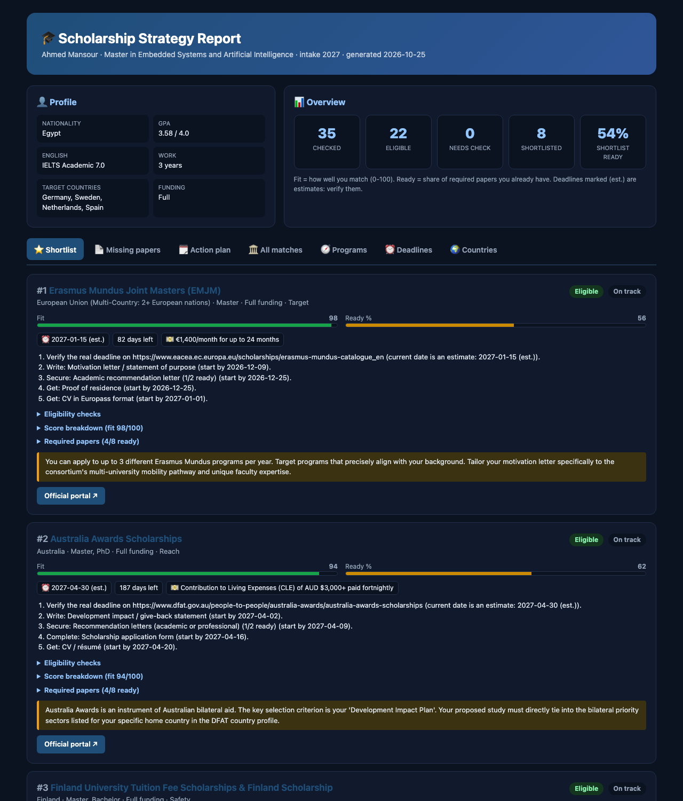
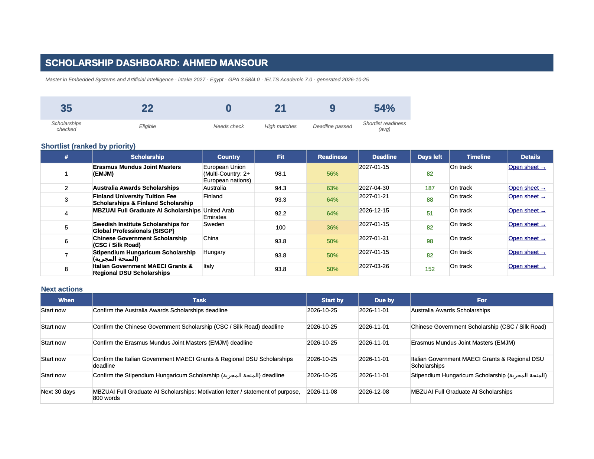
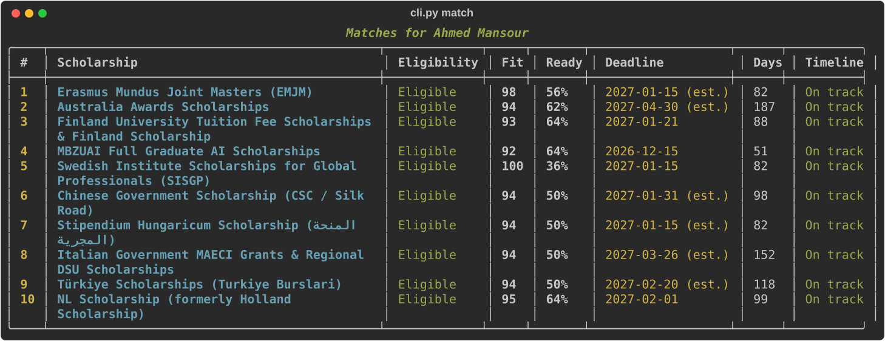
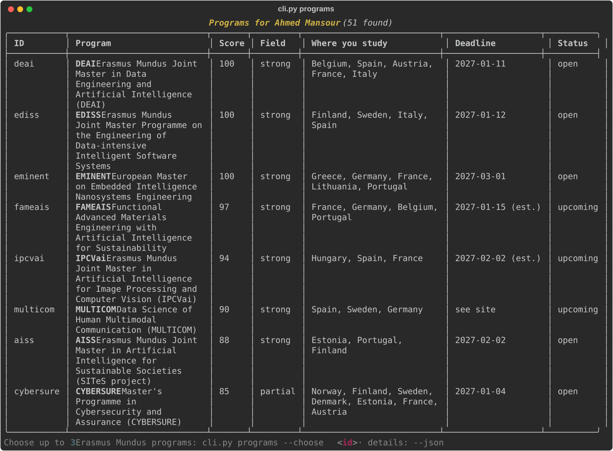
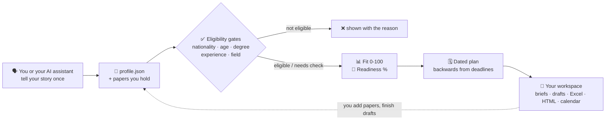

<div align="center">

# 🎓 Scholarship Navigator

### Find the scholarships you can actually win, and never miss a deadline again.

Eligibility checks · match scores · missing papers · a dated plan · essay drafts<br>
**Free, open source, and built to work inside your AI assistant.**

[](LICENSE)
[](pyproject.toml)
[](https://github.com/OmarZen/scholarship-navigator/actions/workflows/tests.yml)
[](#-use-it-with-your-ai-assistant)
[](docs/SCHOLARSHIPS.md)
[](docs/PROGRAMS.md)
[](CONTRIBUTING.md)

[](https://github.com/OmarZen/scholarship-navigator/stargazers)
[](https://github.com/OmarZen/scholarship-navigator/graphs/contributors)
[](https://github.com/OmarZen/scholarship-navigator/commits/main)
[](https://github.com/OmarZen/scholarship-navigator/issues?q=is%3Aopen+label%3A%22good+first+issue%22)

[**Quick start**](#-quick-start) · [**Use with AI**](#-use-it-with-your-ai-assistant) · [**Features**](#-features) · [**What's covered**](#-whats-covered) · [**Contribute**](#-contributing) · [**العربية**](#-بالعربي)



</div>

---

## The problem

Every year, thousands of strong students miss fully funded scholarships. Usually they were good enough. What went
wrong was something else:

- they found out about the scholarship **after the deadline**;
- they spent weeks on an application they were **never eligible for** (wrong nationality, age or field);
- they were **one paper short**: a missing recommendation letter, an expired IELTS, a transcript without apostille;
- the information was spread across **hundreds of outdated blog posts** and WhatsApp forwards.

**Scholarship Navigator fixes that.** Tell it about yourself once. It checks every rule, scores how well you
match, lists exactly which papers you're missing, and builds a plan with real dates, backwards from each deadline.

---

## ✨ What it looks like

> **You:** I'm Egyptian, BSc in electronics engineering, GPA 3.58/4, IELTS 7.0, 3 years of work. I want a fully
> funded master's in AI or embedded systems in Europe, starting 2027.
>
> **Your AI assistant (using Scholarship Navigator):**
> - ✅ You're eligible for **56 of 103** scholarships. ❌ 47 aren't open to you, and here's why (nationality list, age limit, field).
> - 🏠 7 of them let you study **in Egypt** without travelling (AUC, Zewail City, E-JUST, ASRT...), if you'd rather stay home.
> - 🥇 **Erasmus Mundus**: fit **98/100**, papers **56%** ready, deadline **15 Jan 2027** (estimated, verify). Start your motivation letter by **9 Dec**.
> - 🧭 Programs that fit you: **DEAI** (Belgium · Spain · Austria · France · Italy), **EDISS** (Finland · Sweden · Italy · Spain), **EMINENT**. Pick up to 3.
> - ⏰ **Chevening already closed** on 6 Oct 2026. Next round ≈ Oct 2027.
> - 📄 Missing papers: 2nd academic reference, Europass CV, proof of residence, medical certificate.
> - 📁 Everything is saved in `output/ahmed-mansour/`: one folder per scholarship, essay drafts, an Excel tracker and a calendar.

That's a real run on the demo profile in [`examples/sample_candidate_full.json`](examples/sample_candidate_full.json).

---

## 🆚 Why not just a list, or just a chatbot?

| | Scholarship lists & blogs | Asking a chatbot | **Scholarship Navigator** |
|---|:---:|:---:|:---:|
| Tells you if **you** are eligible, rule by rule | ❌ | ⚠️ guesses | ✅ official country lists, age, degree, experience, field |
| A score, and **why** | ❌ | ❌ | ✅ 0-100 with a visible breakdown |
| Exactly which **papers** you're missing, and when to start | ❌ | ⚠️ generic | ✅ 47 paper types with lead times |
| Deadlines with **source and verification date** | ⚠️ often stale | ❌ training-data dates | ✅ confirmed / published / estimated |
| **Remembers you** across sessions | ❌ | ❌ | ✅ personal workspace |
| Drafts tailored to **each** program | ❌ | ⚠️ | ✅ the program's own prompts and word limits |
| Excel tracker, HTML report, calendar | ❌ | ❌ | ✅ |
| Free, private, open source | varies | ❌ | ✅ runs on your computer |

---

## 🚀 Quick start

```bash
git clone https://github.com/OmarZen/scholarship-navigator.git
cd scholarship-navigator
python3 -m venv .venv && .venv/bin/pip install -e ".[mcp]"
```

Then either **talk to your AI assistant** in this folder (next section), or run the interview yourself:

```bash
.venv/bin/python cli.py assess        # answers a few questions → builds output/<your-name>/
```

Or copy [`sample_candidate.json`](sample_candidate.json) (dummy data showing every field), fill in your own details
and run `.venv/bin/python cli.py init --profile my_profile.json`.

Open `output/<your-name>/INDEX.md` and `reports/scholarship_tracker.xlsx`. That's it.

---

## 🤖 Use it with your AI assistant

Scholarship Navigator ships with **7 agent skills**, an **MCP server** with 16 tools, and an `AGENTS.md`, so any
modern assistant knows how to use it. **Step 0** for every tool: install the project (see [Quick start](#-quick-start)).
Full guide with every menu and config file: **[docs/AI_TOOLS.md](docs/AI_TOOLS.md)**.

| Assistant | Open this folder and it just works | Install the skills for every folder |
|---|---|---|
| **Claude Code** | ✅ skills (`.claude/skills/`) + MCP server (`.mcp.json`) | `python scripts/install_skills.py --tool claude` |
| **Claude app** (claude.ai · Desktop) | – | `--tool claude-app`, then upload the ZIPs in **Customize → Skills** |
| **OpenAI Codex** | ✅ `AGENTS.md` + `.agents/skills/` | `--tool codex` |
| **GitHub Copilot** (VS Code · CLI) | ✅ `AGENTS.md` + `.agents/skills/` | `--tool copilot` |
| **Cursor** | ✅ `AGENTS.md` + `.agents/skills/` | `--tool cursor` |
| **Gemini CLI** | ✅ `GEMINI.md` + `.agents/skills/` | `--tool gemini` |
| **Windsurf** | ✅ `.agents/skills/` | `--tool windsurf` |
| **Google Antigravity** | ✅ `.agents/skills/` | `--tool antigravity` |

The install script also prints the **MCP server settings for your tool** with your real paths filled in
(`python scripts/install_skills.py --tool cursor --mcp-only`).

<details><summary><b>Claude Code: step by step</b></summary>

1. `cd scholarship-navigator && claude`
2. Approve the `scholarship-navigator` MCP server when asked (`/mcp` shows it). The skills load by themselves.
3. Ask: *"Help me find a fully funded master's scholarship. Interview me first."*
4. Want it in every folder? `python scripts/install_skills.py --tool claude`, then
   `claude mcp add --scope user scholarship-navigator -- /path/to/scholarship-navigator/.venv/bin/python /path/to/scholarship-navigator/mcp_server.py`
</details>

<details><summary><b>Claude app (claude.ai, Claude Desktop): step by step</b></summary>

1. `python scripts/install_skills.py --tool claude-app` → ZIP files in `dist/claude-skills/`.
2. In Claude: **Customize → Skills** (older versions: Settings → Capabilities), turn on code execution,
   **Upload skill**, and upload each ZIP.
3. Claude Desktop only: Settings → Developer → **Edit Config** and paste the MCP block printed by the script
   (`--tool claude-app --mcp-only`), then restart Claude Desktop.
</details>

<details><summary><b>OpenAI Codex (CLI, IDE extension, app): step by step</b></summary>

1. `cd scholarship-navigator && codex`: Codex reads `AGENTS.md` and `.agents/skills/` (type `/skills`, or `$scholarship-finder-planner`).
2. Every folder: `python scripts/install_skills.py --tool codex` (installs to `~/.agents/skills`).
3. MCP server: `codex mcp add scholarship-navigator -- /path/to/scholarship-navigator/.venv/bin/python /path/to/scholarship-navigator/mcp_server.py`
</details>

<details><summary><b>GitHub Copilot, Cursor, Gemini CLI, Windsurf, Antigravity: step by step</b></summary>

1. Open the folder in the tool (VS Code: switch Copilot Chat to **Agent** mode). The skills in `.agents/skills/`
   load automatically.
2. Every folder: `python scripts/install_skills.py --tool copilot` (or `cursor`, `gemini`, `windsurf`, `antigravity`).
3. MCP server: run the same command with `--mcp-only` and paste the block it prints into the file it names
   (`.vscode/mcp.json`, `~/.cursor/mcp.json`, `~/.gemini/settings.json`, `~/.codeium/windsurf/mcp_config.json`,
   `~/.gemini/config/mcp_config.json`).
</details>

Then just ask, in any language:

```text
"Help me find a fully funded master's scholarship. Interview me first."
"I can't travel abroad. Which scholarships let me study in Egypt?"
"Which Erasmus Mundus programs fit a civil engineer who wants Spain or Portugal?"
"What should I do this week for my applications?"
"Write my Chevening leadership essay from my story bank."
"ساعدني ألاقي منحة ماجستير ممولة بالكامل في أوروبا"
```

| Skill | What it does |
|---|---|
| 🧭 `scholarship-finder-planner` | the main entry: matching, scores, missing papers, plan, reports |
| 🗣️ `scholarship-intake` | interviews you (in your language) and builds your profile |
| 🎯 `scholarship-program-finder` | picks Erasmus Mundus / Intra-Africa programs by field and country |
| ✍️ `scholarship-essay-writer` | essays, motivation letters, referee requests, with a review loop |
| 🔎 `scholarship-deadline-verifier` | turns estimated deadlines into verified facts |
| 📆 `scholarship-progress-coach` | weekly check-ins: what's due, what's done |
| 🛠️ `scholarship-data-maintainer` | adds and updates scholarships with official sources |

---

## 🧩 Features

| | |
|---|---|
| ✅ **Eligibility engine** | nationality (official lists, OECD DAC list), residence, age, degree level (Diploma to Postdoc), degree recency, work experience, restricted fields, return-home obligations, teaching language, awards reserved for women. Missing info → *Needs Check* with the exact fix. |
| 🏠 **Study at home or abroad** | can't travel, or your family prefers you study locally? Choose `home` and you only get awards that fund study **in your own country** (domestic and in-country scholarships). Choose `abroad`, or `both` (the default). |
| 📊 **Fit score 0-100** | academic record vs each scholarship's minimum *and* competitive level, language (TOEFL / Duolingo / PTE converted), experience, field, leadership, research, your preferences. Every point is explained. |
| 📄 **Missing papers** | what you have, what's missing, how long each paper takes, when to start, and expiry checks (e.g. an IELTS that expires before the deadline). |
| 🗓️ **Dated action plan** | scheduled backwards from deadlines; shared papers become one task; overdue items flagged. |
| 🧭 **Program finder** | 56 Erasmus Mundus and Intra-Africa programs with host countries, universities, status and 2027 deadlines; choose 3, get tailored letters. |
| 📁 **Personal workspace** | one folder per scholarship with essay and letter drafts that use the program's own prompts; your work is never overwritten. |
| 📈 **Excel tracker** | dashboard, ranked matches, one sheet per scholarship, live readiness formulas, `sync` your edits back. |
| 🌐 **HTML report + 📅 calendar** | offline interactive report and an `.ics` file with deadline and "start by" reminders. |
| ✍️ **Writing helpers** | STAR essay review, supervisor cold emails, recommendation-letter drafts and brag sheets, fee-waiver emails. |
| 🌍 **Life-after-award guides** | funding-gap and blocked-account calculator, credential recognition and apostille, visa and arrival checklists, study and work rules for 18 countries. |

<details>
<summary><b>📸 More screenshots</b></summary>

**Excel dashboard**



**`cli.py match`**



**`cli.py programs`**



</details>

---

## 🧠 How it works



| Step | Measures | Result |
|---|---|---|
| **Eligibility** | hard rules | Eligible · Needs Check · Ineligible |
| **Fit** | academic, language, experience, field, leadership, research, preferences | High ≥ 80 · Moderate ≥ 62 |
| **Readiness** | share of required papers you hold | updates live |
| **Timeline** | days left vs how long the missing papers take | On track · Tight · At risk · Not feasible · Passed |
| **Priority** | 55% fit + 20% readiness + funding + time left | ranks your shortlist |

Full details: [scoring reference](skills/scholarship-finder-planner/references/scoring.md).

---

## 📚 What's covered

**103 scholarships** from **Diploma to PhD** ([full table](docs/SCHOLARSHIPS.md)), including:

- **Study abroad:** Chevening · Commonwealth · Gates Cambridge · Clarendon · Rhodes · Knight-Hennessy · Fulbright ·
  Erasmus Mundus · DAAD (EPOS, Helmut-Schmidt, doctoral) · Heinrich Böll · Deutschlandstipendium · Eiffel ·
  Stipendium Hungaricum · Swedish Institute · Romania · Russia · Schwarzman · Yenching · MEXT · GKS · CSC ·
  Türkiye Burslari · KAUST · MBZUAI · HBKU · Khalifa · ICCR India · KNB Indonesia · Malaysia · Brunei · ADB-Japan ·
  JJ/WBGSP · JISP · Mexico AMEXCID · Australia Awards · Manaaki NZ, and more.
- **Study in your own country (no travel):** 🇪🇬 منحة علماء المستقبل (Future Scholars) · Zewail City · AUC · Nile
  University · Sawiris · E-JUST · ASRT · ITI · DEPI · 🇹🇷 TÜBİTAK 2210/2211 · 🇮🇩 LPDP · 🇲🇽 SECIHTI · 🇳🇬 PTDF ·
  DAAD In-Country/In-Region (Africa) · Pan African University · AIMS.
- **Diploma level:** MEXT College of Technology / Specialized Training College · GKS Associate · ICTP
  Postgraduate Diploma · ITI 9-month program · Brunei · AMCI Morocco.
- **For women:** AAUW International Fellowships · IAEA Marie Skłodowska-Curie Fellowship · British Council Women
  in STEM.
- **National programs to go abroad:** Egyptian missions · Bolashak · Becas Chile · Saudi Custodian · PTDF
  Overseas · Onsi Sawiris (Amideast).

**56 programs** taught in **37 host countries** ([full table](docs/PROGRAMS.md)): Erasmus Mundus Joint Masters in
engineering, energy, AI & data, cybersecurity, robotics, photonics, quantum, materials, nuclear, agriculture,
design and more, plus Intra-Africa mobility projects. Each lists its universities, status, 2027 deadline and
English requirement.

**Plus:** 47 paper types · study and work guides for 18 countries · credential recognition (uni-assist, CIMEA, WES,
apostille) · visa and housing checklists.

Every deadline, country list and program status carries its **official source and verification date** (last full
review: October 2026).

---

## 🗂️ Your workspace

```text
output/<your-name>/
├── INDEX.md            ← start here: shortlist, next actions, missing papers, programs that fit you
├── PROFILE.md          ← who you are, papers on file, missing profile info
├── AGENTS.md           ← rules any AI assistant follows in this folder
├── profile/            ← profile.json · documents.json · story_bank.md · identity/ academic/ language/ ...
├── scholarships/
│   └── erasmus-mundus/ ← SCHOLARSHIP.md · status.json · essays/ · letters/ · recommendations/ · forms/ · submitted/
└── reports/            ← scholarship_tracker.xlsx · scholarship_report.html · deadlines.ics · action_plan.md
```

<details>
<summary><b>🛠️ All commands</b></summary>

| Command | Purpose |
|---|---|
| `assess` · `init --profile F` · `build` | create or refresh your workspace |
| `location home` · `location abroad` · `location both` | where you will study: your own country (no travel), abroad, or either |
| `match [--details N] [--json]` | eligibility, fit breakdown and readiness for every scholarship |
| `programs [--field robotics] [--country Spain,France] [--choose ID]` | Erasmus Mundus / Intra-Africa program finder |
| `gaps` · `docs list` · `docs set <paper> --status have` | missing papers; record what you have |
| `deadline --scholarship S --date D --source URL` | record a verified deadline |
| `status --scholarship S --set Submitted` | track each application |
| `sync` | import edits you made in the Excel tracker |
| `plan` · `html-report` · `calendar` · `portfolio` | individual reports |
| `review-essay` · `email-professor` · `draft-lor --brag-sheet` · `fee-waivers --email` | writing helpers |
| `list [--degree Diploma] [--nationality Egypt --location home]` | browse the database: by degree, who can apply, study at home or abroad |
| `finance` · `credentials` · `interview` · `visa-guide` · `countries` | guides and calculators |
| `validate` · `export-schema` · `new-scholarship` | data maintenance |
| `scrape` · `discover` · `verify` | live web checks (`pip install -e ".[scrape]"`) |

Run commands as `.venv/bin/python cli.py <command>`, or as `scholarship <command>` after `pip install -e .`. Most
commands accept `--json`.

</details>

---

## 🗺️ Roadmap

- [x] Eligibility engine, fit scores, readiness, dated plans
- [x] Erasmus Mundus & Intra-Africa program finder
- [x] Agent skills, MCP server, `AGENTS.md`
- [x] Study at home or abroad, Diploma level, awards for women, 103 scholarships
- [ ] More scholarships: national programs for more countries, US and Canadian university fellowships
- [ ] Funded PhD positions finder
- [ ] Automatic deadline monitoring (alert when an official page changes)
- [ ] Web app for people without an AI assistant
- [ ] Translations of the interface and guides (Arabic, French, Spanish, Portuguese, Turkish...)

Want one of these? [Open an issue](https://github.com/OmarZen/scholarship-navigator/issues) or send a pull request.

---

## 🤝 Contributing

The most valuable contribution is **accurate data**: a new scholarship, a corrected deadline, a verified program
status. No coding needed; [CONTRIBUTING.md](CONTRIBUTING.md) walks you through your first pull request in 10
minutes. Developers: tests, CI and JSON schemas are ready for you.

<a href="https://github.com/OmarZen/scholarship-navigator/issues?q=is%3Aopen+label%3A%22good+first+issue%22"><b>🌱 Good first issues</b></a> ·
<a href="https://github.com/OmarZen/scholarship-navigator/issues/new/choose"><b>➕ Suggest a scholarship</b></a> ·
<a href="https://github.com/OmarZen/scholarship-navigator/issues/new/choose"><b>📅 Report an outdated deadline</b></a> ·
<a href="https://github.com/OmarZen/scholarship-navigator/discussions"><b>💬 Ask a question</b></a> ·
<a href="CONTRIBUTING.md"><b>🧑‍💻 Contribute code</b></a>

**How contributions are reviewed:** you open a pull request from your fork → tests and data checks run
automatically → it is labelled by area → a maintainer reviews it (every pull request is reviewed before merging)
→ squash-merged into `main`. Nobody pushes to `main` directly. Details: [CONTRIBUTING.md](CONTRIBUTING.md#how-review-works).

### 💛 Contributors

Every merged pull request puts your GitHub account here. The table is refreshed automatically after each merge
(`scripts/update_contributors.py`); the picture below updates by itself.

<!-- CONTRIBUTORS:START -->
<table>
  <tr>
    <td align="center" valign="top" width="14%"><a href="https://github.com/OmarZen"><br /><sub><b>@OmarZen</b></sub></a><br /><sub>3 commits</sub></td>
    <td align="center" valign="top" width="14%"><a href="https://github.com/hansi2007"><br /><sub><b>@hansi2007</b></sub></a><br /><sub>1 commit</sub></td>
  </tr>
</table>
<!-- CONTRIBUTORS:END -->

<a href="https://github.com/OmarZen/scholarship-navigator/graphs/contributors">
  
</a>

---

## ❓ FAQ

<details><summary><b>Is it free?</b></summary>
Yes. MIT-licensed, no accounts, no ads, no paid tier.
</details>

<details><summary><b>I can't travel. Can it find scholarships in my own country?</b></summary>
Yes. Set <code>"study_location": "home"</code> in your profile (or run <code>cli.py location home</code>, or just tell
your AI assistant). You then only see awards that fund study in your own country, such as national postgraduate
scholarships and in-country programs, and every other award says why it doesn't fit. <code>both</code> shows home and
abroad together. Browse without a profile: <code>cli.py list --nationality Egypt --location home</code>.
</details>

<details><summary><b>Does it apply for me?</b></summary>
No. It tells you where you can apply, what you're missing, when to start each step, and drafts your texts. You
submit on the official portals yourself.
</details>

<details><summary><b>Is my data safe?</b></summary>
Everything stays on your computer in <code>output/</code>, which is git-ignored. The tool never needs passport
numbers, ID numbers or bank details. If you use an AI assistant, your conversation follows that provider's privacy
terms.
</details>

<details><summary><b>How accurate are the deadlines?</b></summary>
Each one is marked <i>confirmed</i> (you verified it), <i>published</i> (official date found, with its source) or
<i>estimated</i> (the usual yearly pattern). Always confirm on the official site before applying. The plan tells you
which ones to check.
</details>

<details><summary><b>My scholarship isn't listed.</b></summary>
Run <code>cli.py new-scholarship &lt;id&gt;</code>, fill in the template from the official page, and it's matched like
the others. Then please share it with everyone through a pull request.
</details>

<details><summary><b>Do I need to know how to code?</b></summary>
No. With an AI assistant you just chat. Without one, <code>cli.py assess</code> asks you questions and builds
everything.
</details>

---

## 🌍 بالعربي

**Scholarship Navigator** أداة مجانية ومفتوحة المصدر بتساعدك تلاقي المنح اللي تقدر تكسبها فعلاً. بتحكي عن نفسك مرة واحدة، وهي:

- ✅ بتقولك إنت مؤهل لأنهي منح، والسبب لو مش مؤهل.
- 📊 بتديك درجة توافق من ١٠٠ مع شرح كل جزء فيها.
- 📄 بتقولك الورق الناقص، وتبدأ تجهز كل ورقة امتى.
- 🗓️ بتعملك خطة بمواعيد حقيقية، محسوبة من آخر ميعاد لكل منحة.
- 🧭 بتختارلك برامج إيراسموس موندوس المناسبة لتخصصك والدول اللي بتحبها.
- 🏠 مش هتقدر تسافر؟ اختار «الدراسة في بلدك» وهتطلعلك بس المنح اللي بتمول الدراسة جوه بلدك، أو اختار «الاتنين» عشان تشوف منح الداخل والخارج مع بعض.
- 🎓 بتغطي دبلومة وبكالوريوس وماجستير ودكتوراه، ومنح مخصصة للبنات.
- 📁 بتعملك مجلد لكل منحة، فيه مسودات المقالات وخطابات النية وملف Excel ونتيجة تقويم.

تقدر تستخدمها مع Claude أو Cursor أو أي مساعد ذكاء اصطناعي، وتكلمه بالعربي عادي.
الشرح الكامل بالعربي: [docs/i18n/README.ar.md](docs/i18n/README.ar.md)

---

## ⚠️ Disclaimer

Scholarship Navigator is an independent community project, not affiliated with any scholarship provider,
government or university. Data was researched from official sources (October 2026) but rules and deadlines change
every year: always confirm on the official website. Scores are guidance, not predictions of selection.

## ⭐ Support the project

If it helped you (or could help someone you know):

- **star the repository**, so more students find it;
- **share it** in your university, student and scholarship groups;
- **add one scholarship** from your country.

### Star history

<a href="https://www.star-history.com/#omarzen/scholarship-navigator&Date">
  <picture>
    <source media="(prefers-color-scheme: dark)" srcset="https://api.star-history.com/svg?repos=omarzen/scholarship-navigator&type=Date&theme=dark" />
    <source media="(prefers-color-scheme: light)" srcset="https://api.star-history.com/svg?repos=omarzen/scholarship-navigator&type=Date" />
    
  </picture>
</a>

## License

[MIT](LICENSE) © 2026 [OmarZen](https://github.com/OmarZen).
